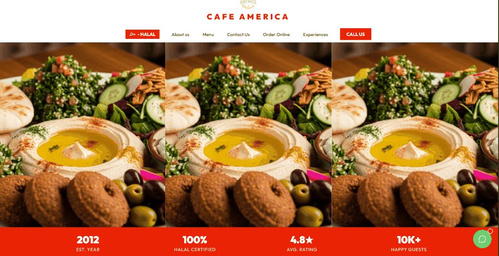
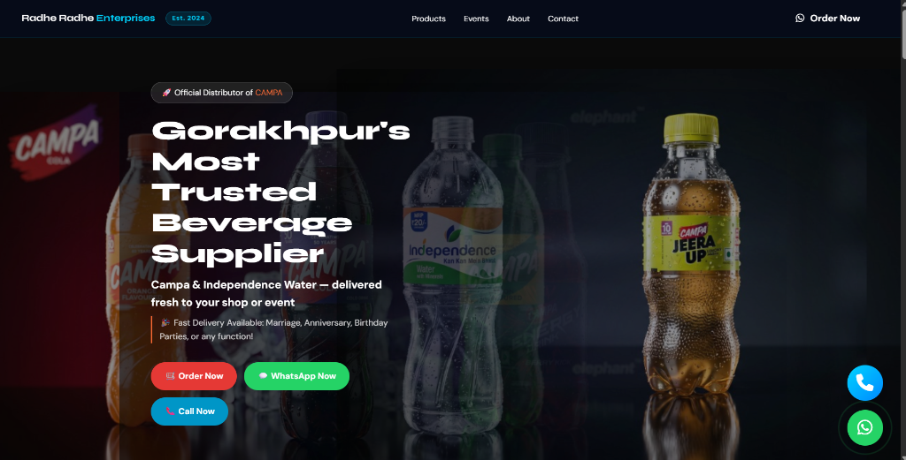

<div align="center">

# Hey there, I'm **Sumit Yadav** 👋

### Full-Stack Developer · AI/ML & Automation

**B.S. Data Science, IIT Madras** · **B.Tech CSE (AI), UIET Kanpur**

<br>

*I build end-to-end systems — automation pipelines, computer-vision applications, and full-stack web products — and ship them to production rather than leaving them as tutorials.*

</div>

<br>

## Currently

Deepening full-stack and AI/ML skills — working across computer vision, backend automation, and modern web deployment.

## 🛠️ Tech Stack & Expertise

[](https://skillicons.dev)
<br>
[](https://skillicons.dev)

```text
⚡ TECHNICAL ECOSYSTEM MATRIX
├── 💻 Languages       : Python · TypeScript · JavaScript · C/C++ · Go · HTML5/CSS3
├── 🌐 Web & Frontend   : Next.js · React · Three.js · Tailwind CSS · Flutter · Streamlit
├── 🤖 AI/ML & Vision   : OpenCV · MediaPipe · Scikit-learn · Browser Automation (Playwright / CDP) · NLP
├── 🗄️ Backend & Data   : Pandas · NumPy · Supabase · PostgreSQL · Firebase · SMTP/APIs
├── 📦 DevOps & Build   : Docker · Gradle · GitHub Actions · Vercel
└── 🛠️ Tools           : Git · GitHub · Android Studio (IDE) · Visual Studio Code · Antigravity
```


---

## Featured Projects

### Full-Stack Web Builds

Client-style demo builds designed and deployed to demonstrate production-grade UI/UX and full-stack delivery.

<table>
<tr>
<td width="50%">



**Cafe America**
Modern café/restaurant web experience, responsive design, deployed end-to-end.

🔗 [Live Demo](https://cafe-america.vercel.app)

`TypeScript` `Next.js` `Vercel`

</td>
<td width="50%">



**Radhe-Radhe Enterprises**
Business/enterprise company website, built and deployed as a client-ready demo.

🔗 [Live Demo](https://radhe-green.vercel.app)

`HTML/CSS` `Vercel`

</td>
</tr>
<tr>
<td colspan="2">

**[Inji Interop Playground](https://github.com/sumityadavv1452/inji-interop-playground)**  
Modular interoperability testing environment built on open-source digital identity standards and playground protocols.

🔗 [Repository](https://github.com/sumityadavv1452/inji-interop-playground)

`TypeScript` `Web Standards`

</td>
</tr>
</table>

### AI / ML / Automation

**[Swiggy Instamart Assistant](https://github.com/sumityadavv1452/Swiggy-Instamart-Automation-Assistant)**  
Autonomous grocery order agent featuring real-time CDP session control, smart free-delivery fee optimization, and payment dispatch.  
`Python` `Playwright` `Streamlit`

**[GraphHacks](https://github.com/sumityadavv1452/GraphHacks)**  
Automation utility script for activity mapping and visual matrix data generation.  
`JavaScript` `Node.js`

**[Email Automation System](https://github.com/sumityadavv1452/Email-Automation-System)**
End-to-end automation tool for personalized bulk email delivery — SMTP & Email API support, HTML templating, retry logic, scheduling, and full delivery logging.
`Python` `SMTP` `Pandas` `APScheduler`

**[Gesture Mouse Control](https://github.com/sumityadavv1452/Gesture-Mouse-Control)**
Real-time computer-vision system mapping hand gestures to mouse cursor control.
`Python` `OpenCV`

**[Virtual Ink](https://github.com/sumityadavv1452/Virtual-Ink)**
Touchless, gesture-based virtual writing tool built with computer vision.
`Python` `OpenCV`

**[News Authenticator](https://github.com/sumityadavv1452/News-Authenticator)**
Tool for analyzing news content to help flag potential misinformation.
`Python` `NLP`

---

## Contact

- **Email:** sumit1452yadav@gmail.com
- **LinkedIn:** [linkedin.com/in/sumit-yadav-b96285348](https://www.linkedin.com/in/sumit-yadav-b96285348)
- **WhatsApp:** [+91 83828 03322](https://wa.me/918382803322)
- **GitHub:** [@sumityadavv1452](https://github.com/sumityadavv1452)
